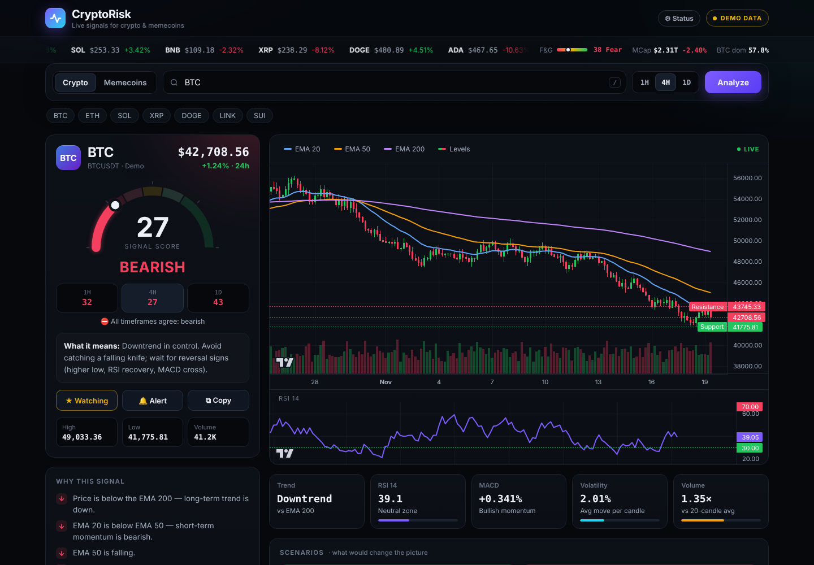

# CryptoRisk

**Live signals and rug-checks for crypto and memecoins, in seconds.**

CryptoRisk is a web dashboard that analyzes any coin or memecoin and turns raw market data into one clear answer: a **0–100 signal score**, a plain-English explanation, and a risk check that flags scam tokens before you touch them.

🔗 **Live demo:** https://cryptorisk.netlify.app


<sub>Screenshot taken in demo mode, so the prices are simulated. The live site uses real market data.</sub>

---

## Features

### 📊 Signal score
- A **0–100 score** with a clear verdict: `BULLISH` · `LEAN BULLISH` · `WAIT` · `LEAN BEARISH` · `BEARISH`
- **"What it means"**: a short, human explanation of what the setup usually implies
- **"Why this signal"**: every factor behind the score, sorted by impact
- **Multi-timeframe consensus**: scores for 1H, 4H and 1D side by side, plus whether they agree

### 📈 Technical analysis
- EMA 20 / 50 / 200, RSI 14, MACD, Bollinger Bands, ATR volatility and volume spikes
- Automatic **support and resistance** detection from swing highs and lows
- **Scenarios**: the breakout and breakdown triggers, next target zones, the level where the bullish setup becomes invalid, and the upside/downside ratio
- **Track record**: the app backtests its own score on the chart you're viewing ("when the score was bullish, price was higher 2 days later in X% of cases") and compares the result with a no-signal baseline

### 🛡️ Memecoin risk check
Each check is scored, and a **HIGH RISK** result overrides the chart signal:
- Liquidity depth and pair age
- 24h volume (catches fake clones with inflated liquidity and zero trading)
- FDV-to-liquidity ratio and buy/sell order flow
- Honeypot detection plus buy and sell taxes
- Mint and freeze authority, owner privileges
- Top-10 holder concentration and LP lock/burn status

### ⚡ Real time
- Live price and candle updates through the Binance WebSocket stream
- Market bar with the top coins, the **Fear & Greed index**, total market cap and BTC dominance
- **🔥 Trending now**: the most-searched coins, one click to analyze

### 🧰 Tools
- **Watchlist scanner** with 7-day sparklines, scores and signals. It rescans automatically every 3 minutes.
- **Price alerts** with browser notifications and sound
- **Copy signal**: a ready-to-post summary for X or Telegram
- **Shareable links** for any asset and timeframe, e.g. `#meme-WIF-1h`
- **System status** page that tests every data source live
- Responsive layout that works on mobile

---

## Data sources

All sources are free, need **no API keys**, and are called straight from the browser. No backend is required.

| Data | Source |
|---|---|
| Crypto prices, candles, live stream | Binance public market data (`data-api.binance.vision`, `data-stream.binance.vision`) |
| Memecoin search, pairs, liquidity, volume | DexScreener |
| Memecoin candles | GeckoTerminal |
| Contract security (honeypot, taxes, holders, LP) | GoPlus Security |
| Trending coins, global market cap | CoinGecko |
| Fear & Greed index | Alternative.me |

If a crypto ticker isn't listed on Binance, the app falls back to its most active DEX pair automatically.

---

## Tech stack

- Vanilla JavaScript with no framework, so the whole app ships as **one self-contained HTML file** (~260 KB)
- [TradingView Lightweight Charts](https://github.com/tradingview/lightweight-charts) for the price and RSI charts
- All indicators and scoring are implemented from scratch in `src/core.js`, a pure module with no DOM access that is testable in Node
- A small Python build script inlines everything into `dist/index.html`

```
src/
  core.js         indicators, scoring, scenarios, backtest, memecoin risk rules
  data.js         API clients, live stream, demo data, system diagnostics
  app.js          UI logic
  template.html   layout and styles
build.py          bundles everything into dist/index.html
dist/index.html   the deployable app
```

---

## Run locally

```bash
npm install          # installs lightweight-charts
python3 build.py     # builds dist/index.html
```

Then open `dist/index.html` in a browser, or serve the `dist` folder with any static server.

## Deploy

The app is a single static file, so you can host it anywhere:

- **Netlify:** drag the `dist` folder onto https://app.netlify.com/drop
- **GitHub Pages / Cloudflare Pages / Vercel:** publish the `dist` folder

When live APIs aren't reachable (for example, in a sandboxed preview), the app switches to clearly labelled **DEMO DATA**.

---

## How the score works

The score starts at a neutral 50. Each factor then adds or subtracts points:

| Factor | Effect |
|---|---|
| Price vs EMA 200 (long-term trend) | ±10 |
| EMA 20 vs EMA 50 (short-term momentum) | ±8 |
| EMA 50 slope | ±4 |
| MACD crossover / histogram direction | ±2 to ±8 |
| RSI zones (overbought / oversold, trend-aware) | −12 to +9 |
| Bollinger Band extremes | ±1 to ±4 |
| Volume spike on a green or red candle | ±6 |
| Distance to support / resistance | ±4 |

The final value is clamped to 0–100. Timeframe consensus weights 1H × 1, 4H × 1.5 and 1D × 2. All weights live in `src/core.js` and are easy to tune.

---

## Roadmap

- [ ] Telegram alerts when a watchlist asset changes signal
- [ ] New-pairs scanner for freshly launched memecoins
- [ ] Accounts with a free tier and a Pro plan
- [ ] Stock market support

---

## Disclaimer

CryptoRisk provides automated technical indicators and risk checks for **educational and informational purposes only**. It is **not financial advice**. Signals are based on historical data and cannot predict the future. Crypto and memecoins are highly volatile, and you can lose all of your money. Always do your own research.

## Author

Built by **Orlixx** · [github.com/Orlixx003](https://github.com/Orlixx003)

## License

[MIT](LICENSE)
